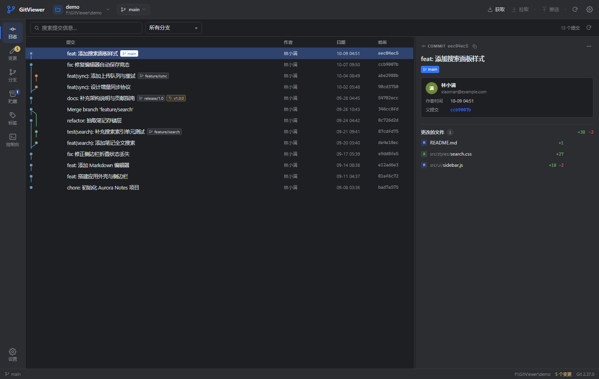
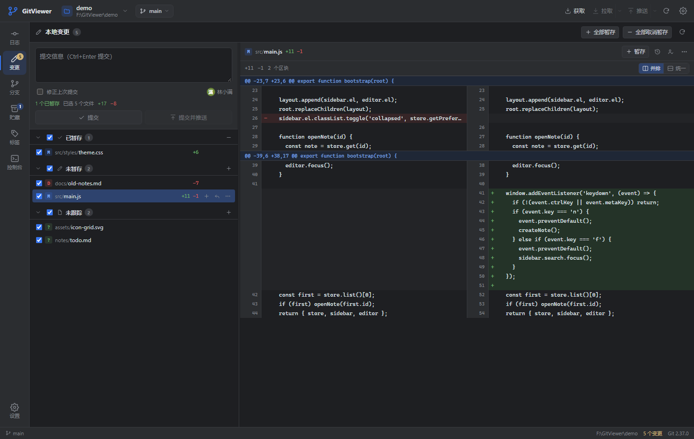
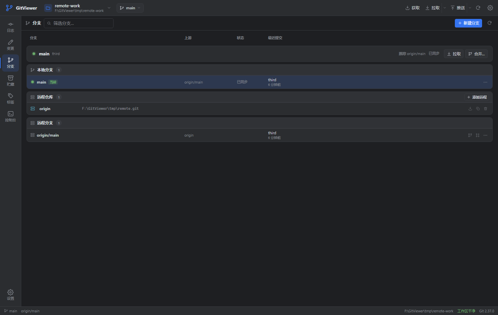
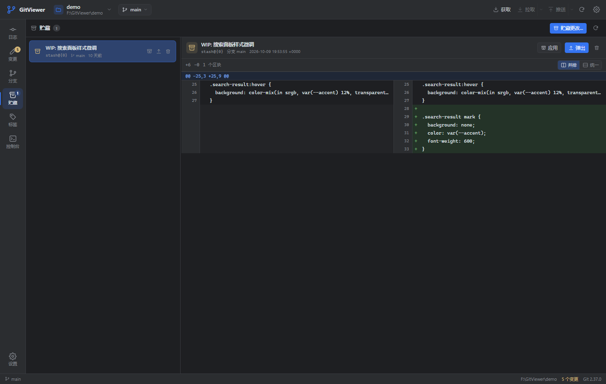
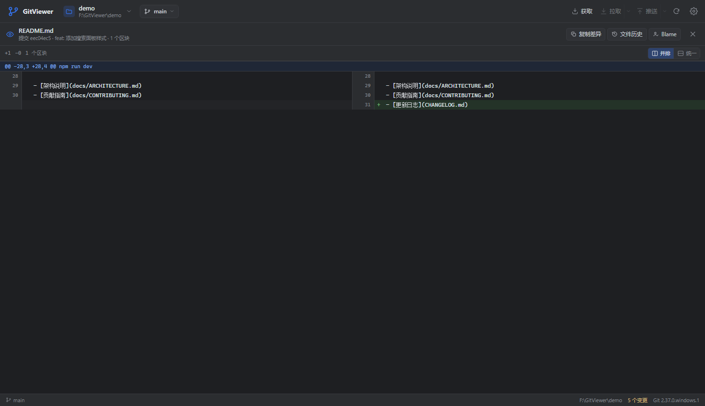
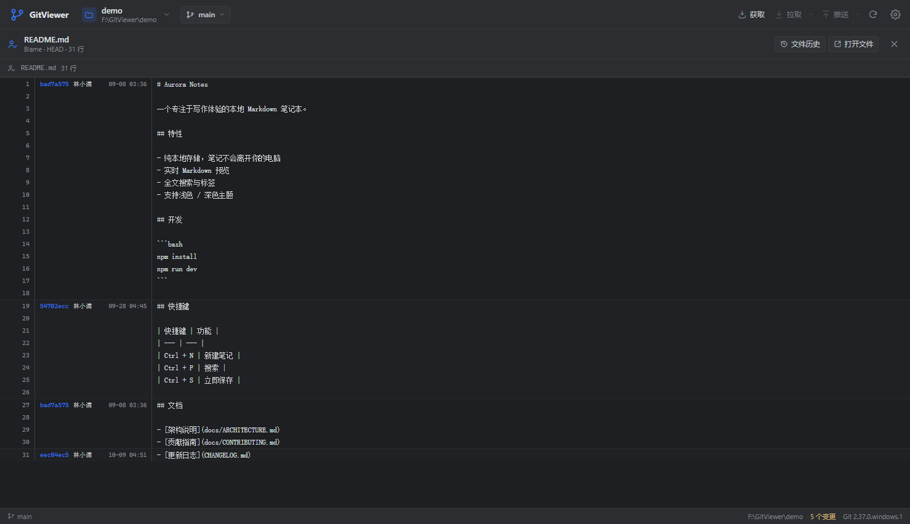
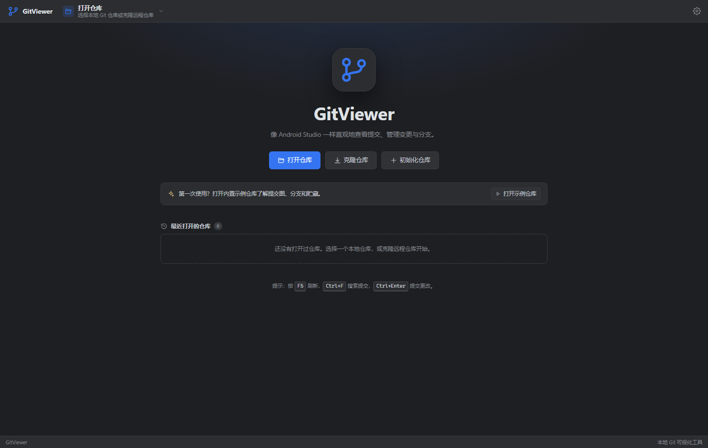
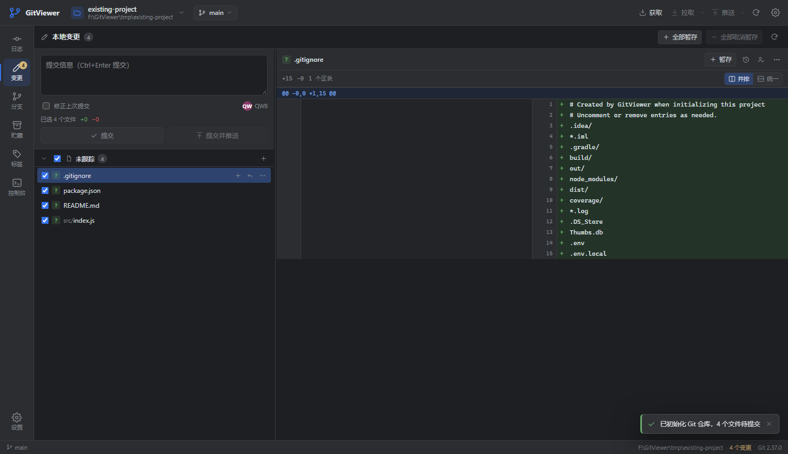

# GitViewer

> 一个类似 Android Studio Git 工具窗口的独立可视化 Git 客户端。
> 不依赖 Android Studio，也不需要安装插件；双击即可打开自己的应用窗口。



GitViewer 使用 **本地 Node.js 服务 + 原生 Web 前端**，通过 Edge / Chrome 的“应用窗口”模式运行。它不修改 Git 的行为，所有操作最终都通过系统 `git` 命令完成，因此和命令行、Android Studio、VS Code 等工具完全兼容。

---

## 为什么做这个工具

Android Studio 的 Git 工具有几个很顺手的点：

- 左侧清晰的 **Local Changes / Log / Console** 结构
- 带分支连线的提交图，以及一眼能看懂的 refs 标签
- 点开提交就能看到作者、时间、完整提交信息和文件列表
- 暂存 / 取消暂存 / 回滚 / 提交的路径很短
- 合并冲突有明确的“我的版本 / 对方版本 / 标记已解决”入口
- 文件历史和 Blame 就在右键菜单里

GitViewer 按这个使用习惯重新实现，并补上了 Diff 视图、Blame、分支管理、贮藏、远程管理等完整流程。

---

## 功能一览

### 提交日志（Log）

- 彩色分支连线提交图，支持合并、分叉与多分支显示
- 提交列表：作者、日期、短哈希、分支/标签/远程 refs
- 按提交信息搜索（`git log --grep`），按分支 / 远程 / 标签过滤
- 文件历史：从任意文件打开该文件的提交历史，图形自动切换为时间线
- 提交详情：完整作者/提交者、父提交、完整 message、文件列表与增删行数
- 提交右键：检出、建分支、打标签、Cherry-pick、Revert、Soft/Mixed/Hard Reset、复制哈希
- 双击 / 点击文件查看该提交下的文件差异

### 本地变更（Local Changes）

- 已暂存 / 未暂存 / 未跟踪 / 冲突四种分组
- 逐文件勾选、暂存、取消暂存、全部暂存、全部取消暂存
- 工作区 ↔ 暂存区、暂存区 ↔ HEAD 的差异
- 并排 / 统一两种 Diff 视图，带行号、Hunk、词级高亮
- 回滚单个或全部更改；未跟踪文件删除前二次确认
- 一键加入 `.gitignore`
- 提交信息输入、修正上次提交、Commit、Commit & Push
- 冲突文件专用视图：工作区（含冲突标记）、我的版本、对方版本、共同祖先
- 合并 / 变基 / 拣选 / 还原进行中的提示，可继续或中止
- 解决全部冲突后可直接完成合并提交



### 分支（Branches）

- 本地分支与远程分支分组，显示上游、ahead/behind、最近提交
- 检出、创建、重命名、删除（未合并时可二次确认强制删除）
- 合并到当前分支、将当前分支变基到目标分支
- 远程分支一键检出为本地跟踪分支
- 远程仓库管理：添加、移除、单独 Fetch、复制地址
- 当前分支卡片：上游状态、发布分支、拉取、合并



### 贮藏（Stash）

- 创建贮藏，可选择包含未跟踪文件
- 查看贮藏的完整 Diff
- 应用（保留）、弹出（应用并删除）、删除
- 贮藏应用冲突时自动跳转到“本地变更”处理



### 标签（Tags）

- 轻量标签 / 附注标签创建，附注标签显示创建日期
- 检出标签（分离 HEAD）、查看标签提交、删除、推送
- 标签过滤与快捷右键菜单

### 差异查看（Diff）

- 并排 / 统一视图自由切换
- 文件新旧行号、Hunk 标题、增删行背景、词级差异高亮
- 二进制文件、超大 Diff、根提交、重命名、删除、未跟踪文件均可处理
- 复制完整 Diff 文本
- 从 Diff 直接打开文件历史或 Blame



### 逐行作者（Blame）与文件历史

- 按提交分组着色，显示短哈希、作者、日期
- 点击提交直接回到提交详情
- 文件历史自动带上路径过滤条件



### Git 控制台（Console）

- 记录 GitViewer 执行的每一条 Git 命令、耗时、退出码、stdout/stderr
- 展开查看完整输出，支持筛选、复制命令/输出、清空
- 排查“为什么没推上去”“为什么合并失败”时非常有用

### 其他

- 打开本地仓库、克隆远程仓库、初始化已有项目（支持非空目录）
- 最近打开的仓库列表（可移除、可发现路径失效）
- 浅色 / 深色主题（默认 Darcula 风格）
- 工作区、分支、暂存等操作后的自动刷新
- 全部界面中文，Windows 下中文路径 / 文件名 / GBK 文件内容做了兼容
- 内置示例仓库，第一次使用可以直接打开体验



---

## 环境要求

| 组件 | 要求 |
| --- | --- |
| 操作系统 | Windows 10 / 11（启动脚本按 Windows 编写；服务端代码本身跨平台） |
| Git | Git for Windows 2.28+（已在 2.37 上测试），需要能在命令行执行 `git` |
| Node.js | 20.11+（已在 Node.js 24 上测试） |
| 浏览器 | Google Chrome（推荐）或 Microsoft Edge（用于打开应用窗口） |

GitViewer 本身 **没有任何 npm 运行时依赖**，不需要 `npm install`。

检查环境：

```powershell
git --version
node --version
```

---

## 快速开始

### 方式一：双击启动（推荐）

双击 **`GitViewer.vbs`**：

- 不显示命令行窗口
- 启动本地服务
- 用 Chrome/Edge 打开一个独立的 GitViewer 应用窗口（默认优先使用 Chrome）

如果希望有桌面快捷方式，双击 **`创建桌面快捷方式.vbs`**，会在桌面生成带图标的 `GitViewer.lnk`。

### 方式二：命令行启动（可看日志）

双击 **`GitViewer.bat`**，或在命令行执行：

```powershell
npm start
```

### 第一次打开

1. 首页点击 **打开仓库**，选择任意本地 Git 仓库；或点击 **克隆仓库**。
2. 已有项目还没有纳入 Git？点击 **初始化仓库**，选择项目文件夹即可（支持非空目录，详见下文）。
3. 想先体验？点击首页的 **打开示例仓库**（需要 `demo/` 目录存在）。
4. 如果没有示例仓库，可以生成：

```powershell
npm run demo
```

> `npm run demo` 会删除并重建 `demo/` 目录，仅用于演示，不要对真实仓库执行。

### 把已有项目纳入 Git

GitViewer 可以直接初始化一个**已经有文件、但还没有 `.git` 的项目**，不需要先把目录清空。

1. 首页点击 **初始化仓库**（或右上角仓库菜单 → **初始化仓库…**）。
2. 选择项目文件夹；可以是非空目录。
3. 保持勾选 **创建推荐 .gitignore**（推荐），GitViewer 会生成一份包含 `.idea/`、`build/`、`node_modules/`、`dist/`、`*.log` 等规则的 `.gitignore`。如果项目中已有 `.gitignore`，不会覆盖。
4. 点击 **初始化仓库**。

初始化只会执行 `git init`（创建 `main` 分支）并可选创建 `.gitignore`，**不会自动暂存或提交任何文件**。初始化完成后会直接进入“本地变更”：

- 现有文件显示为“未跟踪”
- 被 `.gitignore` 排除的文件（如 `node_modules/`）不会出现在列表中
- 确认文件列表后，填写提交信息并提交，即可完成初始版本



> 如果所选目录已经是 Git 仓库，GitViewer 会提示直接打开；如果是某个仓库的子目录，会提示打开外层仓库，避免误建嵌套仓库。

### 退出

- 设置（右上角齿轮）→ **退出 GitViewer**
- 或直接关闭 GitViewer 应用窗口；服务会在几秒后自动退出

---

## 使用说明

### 提交更改

1. 打开 **变更** 视图。
2. 勾选要提交的文件（默认全选）；需要部分提交时取消不需要的文件。
3. 输入提交信息，`Ctrl+Enter` 或点击 **提交**。
4. 需要推送时点击 **提交并推送**。

> 勾选只决定“提交前把哪些文件加入暂存区”。如果暂存区里已有未勾选的文件，它们也会被本次提交包含，界面会给出提示。

### 修正上一次提交

- 勾选 **修正上次提交**，提交信息会自动填入 HEAD 的 message；
- 修改后点击 **提交**，等价于 `git commit --amend`。

### 解决合并冲突

1. 合并 / 变基产生冲突后，GitViewer 会跳到 **变更** 视图。
2. 点击冲突文件，在右侧选择：
   - **工作区（含标记）**：查看 `<<<<<<<` / `=======` / `>>>>>>>`
   - **我的版本** / **对方版本** / **共同祖先**
3. 点击 **使用我的版本** 或 **使用对方版本**，GitViewer 会自动 `git add` 标记为已解决。
4. 所有冲突解决后：
   - 合并：填写提交信息，点击 **提交**（或横幅里的 **完成合并**）
   - 变基 / 拣选 / 还原：点击横幅里的 **继续**

也可以点击 **中止** 放弃当前操作。

### 查看某个文件的历史 / Blame

- 在提交详情的文件列表、变更文件列表、Diff 顶栏上点击 **文件历史** 或 **Blame**。
- 文件历史会回到 Log 视图，并带上 `路径` 过滤标签。
- Blame 会显示每一行的提交、作者和时间，点击哈希回到对应提交。

### 管理远程

- **分支** 视图 → **远程仓库** → **添加远程**。
- 每个远程可以单独 Fetch、复制地址或移除。
- Fetch / Pull / Push 按钮在右上角；Pull 的下拉菜单可以选择 merge / rebase / ff-only。
- 推送按钮的下拉菜单支持 `--force-with-lease` 强制推送。

---

## 快捷键

| 快捷键 | 功能 |
| --- | --- |
| `F5` | 刷新当前仓库 |
| `Ctrl + F` | 聚焦当前视图的搜索框 |
| `Ctrl + Enter` | 在“本地变更”中提交 |
| `Ctrl + O` | 打开仓库 |
| `Alt + 1` … `Alt + 6` | 切换 日志 / 变更 / 分支 / 贮藏 / 标签 / 控制台 |
| `↑` / `↓` | 在提交列表中移动选择 |
| `Esc` | 关闭 Diff 浮层、菜单或对话框 |

---

## 数据与配置

所有本地状态都放在项目的 `data/` 目录（首次运行自动创建）：

```
data/
  settings.json        # 主题、最近仓库、Diff 模式等
  browser-profile-chrome/  # Chrome 应用窗口的独立配置目录（默认）
  browser-profile-edge/    # 仅在强制使用 Edge 时创建
  runtime.json         # 当前服务端口、PID、启动参数
  launch.log           # 启动日志（排查“窗口没打开”时看这里）
```

- 删除 `data/` 即可恢复默认设置。
- 浏览器配置目录是隔离的，不会影响你日常使用的 Edge/Chrome 配置。
- 应用窗口默认优先使用 **Chrome**，避免 Edge 自动登录 Microsoft 账户后弹出“正在同步浏览数据”以及扩展（如 AdGuard）的欢迎页。如果希望强制使用 Edge，可以设置环境变量 `GITVIEWER_BROWSER=edge`；启动参数已禁用同步和扩展，但 Microsoft 账户策略仍可能插入提示。
- GitViewer 只监听 `127.0.0.1`，不会对局域网暴露端口。
- 不会上传仓库内容；所有网络请求都由本机 `git` 直接发起。

默认端口为 `47110`；如果被占用会自动尝试 `47111`、`47112`…… 启动日志里会打印实际地址。

---

## 开发

```powershell
npm start        # 启动服务 + 打开应用窗口
npm run server   # 只启动服务（默认 47110），不打开窗口
npm test         # 运行后端集成测试（8 个用例）
npm run demo     # 重建内置示例仓库
```

### 目录结构

```
GitViewer/
├─ launch.mjs                 # 启动器：启动服务、打开 Edge/Chrome 应用窗口
├─ server/
│  ├─ git.mjs                 # Git 执行器（输出重定向到临时文件、超时、trace）
│  ├─ repo.mjs                # 状态/日志/提交图/差异/Blame/冲突查询
│  ├─ actions.mjs             # 暂存、提交、分支、标签、贮藏、网络、文件对话框
│  ├─ index.mjs               # HTTP 服务、/api/rpc、静态文件
│  ├─ store.mjs               # 设置与最近仓库持久化
│  ├─ trace.mjs               # 请求级 Git 命令追踪
│  └─ util.mjs                # 路径校验、编码、Diff numstat 等工具
├─ public/
│  ├─ index.html
│  ├─ styles.css              # Darcula 风格主题 + 全部界面样式
│  └─ js/
│     ├─ app.js               # 控制器：路由、刷新、操作流程
│     ├─ shell.js             # 顶栏、侧栏、状态栏、设置
│     ├─ state.js / api.js    # 全局状态与 RPC 客户端
│     ├─ components/          # 提交图、Diff、提交详情、冲突、Blame、对话框
│     └─ views/               # 日志、变更、分支、贮藏、标签、控制台、首页
├─ test/api.test.mjs          # 后端集成测试
├─ scripts/make-demo.mjs      # 示例仓库生成器
├─ demo/                      # 示例仓库（可由 npm run demo 重建）
├─ GitViewer.vbs              # 无控制台启动
├─ GitViewer.bat              # 带控制台启动
└─ 创建桌面快捷方式.vbs
```

### 实现要点

- **没有前端构建步骤**：浏览器直接加载 ES Modules，改完刷新即可。
- **Git 输出不走管道**：`server/git.mjs` 将 stdout/stderr 重定向到临时文件再读取，避免 Windows 沙箱 / 受限环境中匿名管道不可用，也避免大 Diff 造成管道死锁。
- **提交图自行计算泳道**：`computeGraph()` 为每个提交分配 lane / 父边 / 合并边 / 穿越线，前端用 Canvas 绘制。按路径或关键字过滤时自动切换为时间线，避免产生误导性的悬空连线。
- **Diff 结构在服务端解析**：Hunk、行号、新增/删除行数、二进制标记都由服务端返回；前端负责并排配对和词级高亮。
- **每条 Git 命令都进入控制台**：基于 `AsyncLocalStorage` 追踪单次 RPC 内的全部命令与输出。

### RPC

前端只调用一个接口：

```
POST /api/rpc
{ "method": "repo.log", "params": { "repo": "F:\\path", "limit": 250, "rev": "HEAD" } }
```

返回：

```json
{ "ok": true, "data": { ... }, "trace": [ { "command": "git log ...", "code": 0, "ms": 32 } ] }
```

失败时返回 `{ "ok": false, "error": { "message": "...", "stderr": "..." } }`，同时保留 trace。

---

## 测试

```powershell
npm test
```

覆盖：

- 仓库初始化、暂存、提交、根提交详情
- 非空项目初始化、推荐 .gitignore、初始提交，以及重复初始化保护
- 工作区 / 暂存区 / 提交 Diff、未跟踪文件 Diff
- 分支创建、切换、合并、冲突检测、三方内容读取、解决冲突、合并提交
- 重命名文件的安全暂存与提交
- 贮藏创建、Diff、应用、回滚、删除
- 附注标签创建 / 删除 / 日期
- 中文路径与中文内容

测试在 `tmp/api-test-*` 下创建临时仓库，结束后自动清理。

---

## 已知限制

- 不支持逐行 / 逐 Hunk 暂存（当前按文件级别暂存）。
- 不支持交互式 rebase（`git rebase -i`）。
- 不支持子模块、LFS 专用界面、GitHub/GitLab PR 集成。
- 没有内置代码编辑器；合并冲突以只读视图 + “采用某一方 / 标记已解决”为主，复杂冲突可点击 **打开文件** 用外部编辑器处理。
- 并排 Diff 对超长代码行会截断显示（悬停可看完整行），可切换到统一视图横向滚动。
- 超大仓库中 `git status --untracked-files=all` 可能较慢，这是 Git 本身的扫描成本。
- 应用窗口依赖本机 Edge/Chrome；没有浏览器时会退化为默认浏览器标签页。

后续可以按需增加：逐 Hunk 暂存、交互式 rebase、多仓库标签页、GitHub PR、语法高亮、子模块等。

---

## 常见问题

**双击 `GitViewer.vbs` 没有反应？**

1. 确认已安装 Node.js，并在新开的命令行里能执行 `node --version`。
2. 双击 `GitViewer.bat` 查看控制台错误。
3. 查看 `data/launch.log`。
4. 检查是否已有 GitViewer 在运行（默认端口 `47110`）。

**提示“无法运行 git”？**

安装 Git for Windows，并在安装时选择把 Git 加入 PATH；重启命令行 / 资源管理器后再试。

**打开 GitViewer 时弹出 Edge 的“正在同步浏览数据”或 AdGuard 欢迎页？**

GitViewer 现在默认用 **Chrome** 打开独立应用窗口，并把同步、扩展和首次运行提示关闭，不会再带入你日常 Edge 账户里的扩展和推广页。如果仍然出现：

1. 关闭所有旧的 GitViewer 窗口；
2. 删除 `data/browser-profile-edge/`（如果有）；
3. 确认没有设置 `GITVIEWER_BROWSER=edge`。

**桌面快捷方式没有图标？**

重新运行 **`创建桌面快捷方式.vbs`**。它会把图标复制到 `%LOCALAPPDATA%\GitViewer\gitviewer.ico` 再写入快捷方式，避免 Windows 无法从某些磁盘读取图标；随后会刷新资源管理器图标缓存。

**窗口没有打开，但服务启动了？**

查看 `data/runtime.json` 里的 `url`，在浏览器手动打开。也可以把 Edge/Chrome 设为默认浏览器后重试。

**端口被占用？**

GitViewer 会自动尝试 `47110`–`47134`。实际地址在 `data/launch.log` / `data/runtime.json` 中。

**关闭窗口后还有 node 进程？**

GitViewer 会在窗口关闭后等待约 8 秒再退出；如果还有另一个 GitViewer 窗口开着，服务会继续运行。也可以在设置里点 **退出 GitViewer** 立即结束。

**会不会把我的代码上传？**

不会。GitViewer 只在本机执行 `git` 命令；网络请求仅由 `git fetch/pull/push/clone` 发出，目标是你配置的远程仓库。

---

## 说明

- GitViewer 是一个本地个人工具，不修改 Git 仓库格式，不写入除 `.gitignore` 和 Git 自身文件之外的仓库内容。
- 回滚、删除分支、Hard Reset、强制推送等操作都有二次确认（可在设置中关闭“执行危险操作前确认”）。
- 建议先在内置示例仓库或测试仓库中熟悉操作，再用于重要项目。
